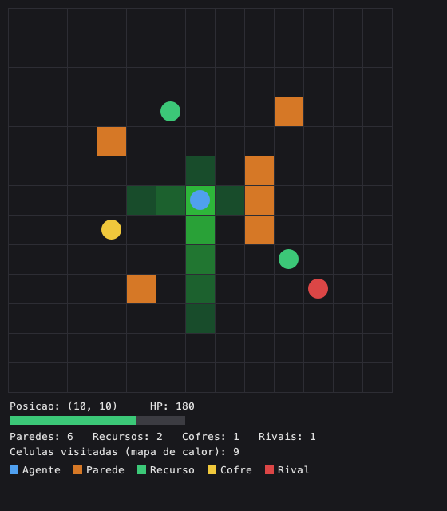

# 🤖 Explorer Agent for the 3D RAG Arena

**An autonomous Java agent that acts as the "brain" of an explorer robot in the 3D RAG Arena.**
Final project for the **Programming III** course at the Polytechnic Institute of Tomar (IPT), built by [Carlos Gameiro](https://github.com/Loogatoxx) and [Afonso Trindade](https://github.com/Afonso4538).


🇵🇹 [Versão portuguesa](README.pt.md)


The agent connects to the Arena's central server through a **REST API**. It perceives the world (radar, telemetry), picks its next move with heuristics, and solves the Plasma Terminal puzzles with a **RAG pipeline** running on a local AI engine (**Ollama**).



*The local telemetry dashboard: a radar centred on the agent, a heat map of visited cells, walls, resources, vaults and rivals. This render uses a sample game state.*

## Architecture (hybrid topology)

- **Central server (cloud / OVH):** the referee of the "physical world" (not ours)
- **Autonomous client (Java, local):** this repository, the robot's nervous system
- **AI engine (Ollama, local, port 11434):** embeddings and generation

| Class | Responsibility |
|---|---|
| `AgenteExplorador` | Orchestrates the Sense → Think → Act loop (main) |
| `ArenaClient` | HTTP REST communication with the Arena (register, perceive, act, unlock) |
| `OllamaClient` | Local AI communication (embeddings + RAG generation) |
| `DocumentoVetorial` | Data model: a text chunk and its embedding vector |
| `PainelMapaCalor` | Swing / Graphics2D dashboard: telemetry and heat map |

## Tech

Java 17+ (`java.net.http.HttpClient`) · Maven · Gson 2.10.1 · Ollama with `nomic-embed-text` (embeddings) and `qwen2.5-coder:0.5b-instruct` (LLM)

## Getting started

1. JDK 17 or later
2. Ollama running on `http://localhost:11434`
3. The models:
   ```bash
   ollama pull qwen2.5-coder:0.5b-instruct-q4_K_M
   ollama pull nomic-embed-text
   ```

## Optimisation & benchmarks

Simulation tools live in `src/test/.../sim/` and are not part of the agent:

- `BenchmarkNavegacao` / `BenchmarkEvolucao` score navigation version by version
- `SimuladorBatalha` runs a free-for-all league of combat strategies
- `OtimizadorLocal` brute-forces thousands of duels locally and writes a JSON report with the best strategy

The analysis reports (combat, Q-learning, hybrid ML, and an honest "why we lost") are in [`docs/`](docs/).

## Project documentation

- [`DIARIO_DE_BORDO.md`](DIARIO_DE_BORDO.md): the complete development log
- [`auditoria_ia/`](auditoria_ia/): each author's audit of their AI usage (prompts and answers)

Documentation and code comments are in Portuguese.
